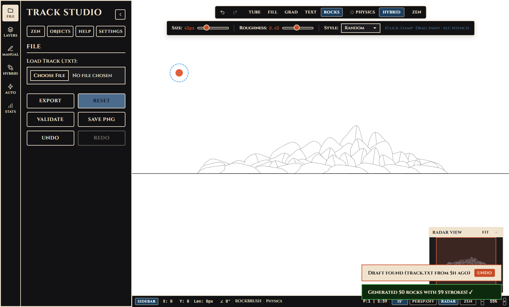
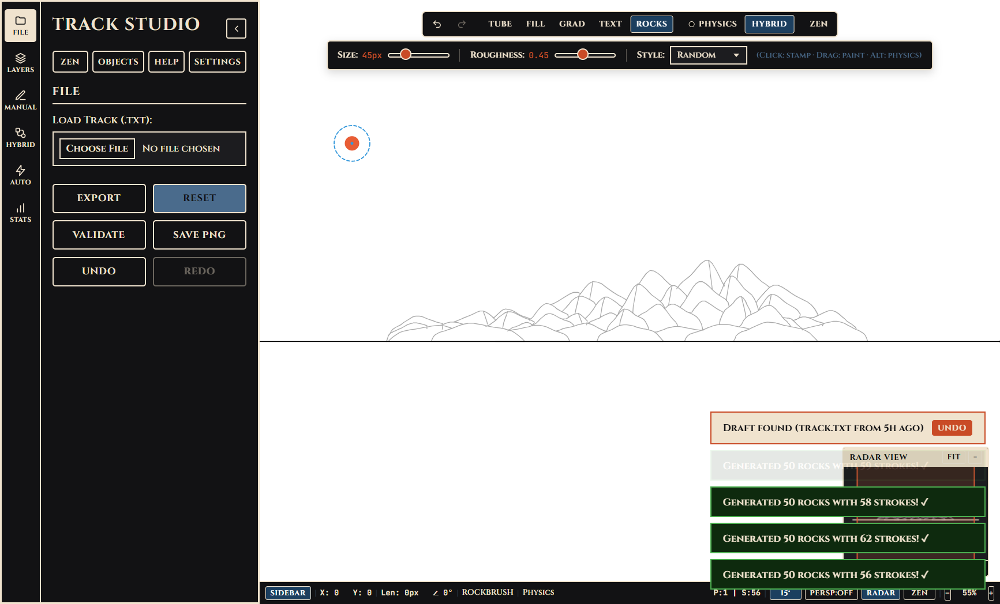
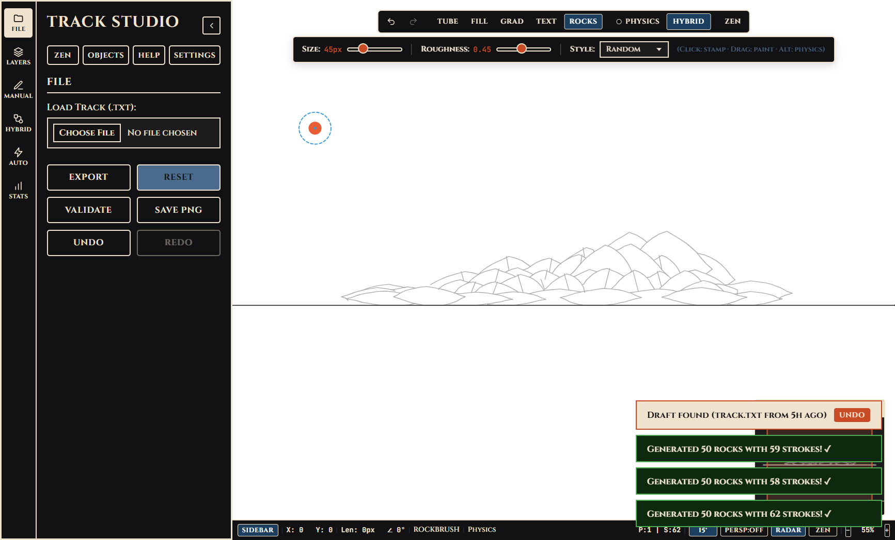

# Track Studio (FRHD Track Editor)

<div align="center">

[](https://github.com/Mountain013/FRHD-Trak-Editor/releases/tag/v1.0.0)
[-0078D6.svg?style=for-the-badge&logo=windows)](https://github.com/Mountain013/FRHD-Trak-Editor/releases/download/v1.0.0/Track.Studio.1.0.0.exe)
[](https://mountain013.github.io/FRHD-Trak-Editor/)
[](LICENSE)

**A professional, high-performance desktop editor and procedural generation studio for Free Rider HD.**

[🌐 **Visit Download Portal (GitHub Pages)**](https://mountain013.github.io/FRHD-Trak-Editor/) • [⬇️ **Download Portable (.exe)**](https://github.com/Mountain013/FRHD-Trak-Editor/releases/download/v1.0.0/Track.Studio.1.0.0.exe) • [📦 **Releases**](https://github.com/Mountain013/FRHD-Trak-Editor/releases)

<br/>



</div>

---

## ⚡ Direct Downloads (v1.0.0)

| Package | Format | Size | Description | Download |
| :--- | :--- | :--- | :--- | :--- |
| **Windows Portable** | `.exe` | ~110 MB | Standalone single binary. No installation required; run from anywhere or a flash drive. | [**Download Portable**](https://github.com/Mountain013/FRHD-Trak-Editor/releases/download/v1.0.0/Track.Studio.1.0.0.exe) |
| **Windows Installer** | `.exe` | ~121 MB | Standard NSIS installer with Desktop and Start Menu shortcuts. | [**Download Setup**](https://github.com/Mountain013/FRHD-Trak-Editor/releases/download/v1.0.0/Track.Studio.Setup.1.0.0.exe) |
| **Web Download Portal** | Web | — | View full feature showcases, live screenshots, and download options in your browser. | [**Open Portal**](https://mountain013.github.io/FRHD-Trak-Editor/) |

---

## 🌟 Key Features

### 🪨 1. Organic Procedural Rock & Scenery Generator
Generate natural, non-repetitive mountain massifs, cliffs, and boulders with zero circular artifacts:
- **Whaleback & Spline Outcrop (Hybrid)**: Combines asymmetric glaciated whaleback domes with natural cubic spline contours.
- **Asymmetric Lamé Superellipses**: Sub-elliptical curvature ($p \in [2.2, 3.8]$) with variable quadrant pinching for geological realism.
- **Glaciated Roche Moutonnée**: Gentle stoss slopes tapering into steep, plucked lee scarps.
- **Natural Spline Curvature**: Cardinal-relaxed multi-scale cubic spline undulations.
- **Harmonic Topographic Field**: Resonant multi-frequency sinusoidal interference landscapes with optional weathered facets and crease lines.

<div align="center">
  
  
</div>

---

### 🎨 2. Modern Creative Desktop GUI
- **Canvas Mini-Map (Radar View)**: Floating interactive radar viewport in the lower-right showing full track bounds. Click or drag to jump across the track instantly (`N` to toggle).
- **Zen / Focus Mode**: Collapse the entire sidebar with one keystroke (`\` or top header button) for an unobstructed fullscreen drawing workspace.
- **Floating Canvas HUD Toolbar**: Instant tool switching directly on canvas (`Line`, `Line+`, `Bézier`, `Brush`, `Eraser`, `Select`, `Modify`), layer toggling, and Zen mode.
- **Interactive Layer Manager**: Independent visibility (`👁️`) and lock (`🔒`) toggles for Physics and Scenery layers, plus Scenery opacity dimming slider for drafting guides.
- **Real-Time Drafting Telemetry**: Status bar monitors live cursor track coordinates `(X, Y)`, live segment length (`Len: 240px`), drawing angle (`∠ -35°`), line count breakdown, and zoom level.

---

### 🛠️ 3. Optimization & Precision Tools
- **3-Point Interactive Bézier Ramp Tool (`R`)**: Draw fluid transition ramps and jumps with start, apex, and landing anchor controls.
- **RDP Line Simplifier (Ramer-Douglas-Peucker)**: Smoothly decimate redundant polyline vertices without changing track rideability.
- **Gap Welder (Snag Fixer)**: Scans and welds invisible sub-pixel cracks to prevent the bike wheel from snagging.
- **Micro-line & Duplicate Purge**: One-click cleanup of zero-length segments and stacked duplicate lines.
- **Auto-Save & Session Recovery**: Periodic background saving with automatic recovery prompt if an unsaved session is detected.

---

## ⌨️ Keyboard Shortcuts Reference

| Key | Tool / Action | Description |
| :--- | :--- | :--- |
| **Q** | **Line Tool** | Standard two-point segment drafting |
| **W** | **Line+ Tool** | Continuous chaining polyline drawing |
| **R** | **Bézier Curve / Ramp Tool** | 3-point interactive quadratic curve generator |
| **A** | **Brush Tool** | Freehand sketching tool |
| **E** | **Eraser Tool** | Circular stroke and segment eraser |
| **F** | **Area Fill Tool** | Solid fill generator |
| **P** | **Polygon Tool** | Multi-point geometric closed shape tool |
| **O** | **Circle Tool** | Parametric circular boundary drafting |
| **S** / **V** | **Box Select Tool** | Marquee selection for batch moving and deleting |
| **M** | **Modify Vertices Tool** | Direct endpoint adjustment and vertex snapping |
| **L** | **Toggle Draw Layer** | Switch between Physics and Scenery drawing |
| **N** | **Toggle Radar View** | Show / hide canvas mini-map overlay |
| **\\** | **Zen Mode** | Expand canvas to maximum width |
| **Space** | **Pan Viewport** | Hold and drag to smoothly pan around track |
| **Shift** | **Snap Modifier** | Snaps cursor to nearest vertex or angle increments |
| **Ctrl / Cmd + S** | **Save / Export** | Save track code (`.txt`, `.frhd`) |
| **Ctrl / Cmd + O** | **Open Track** | Load track code from disk |
| **Ctrl / Cmd + N** | **New Track** | Clear workspace and initialize fresh canvas |
| **Ctrl / Cmd + Shift + S** | **Snapshot** | Export high-resolution PNG image |
| **Ctrl / Cmd + Z** | **Undo** | Revert last action |
| **Ctrl / Cmd + Y** | **Redo** | Reapply undone action |
| **F1** / **?** | **Shortcuts Modal** | Open in-app keyboard guide |

---

## 💻 Building from Source

To run or build the application locally from source:

### Prerequisites
- [Node.js](https://nodejs.org/) (v16 or higher)
- `npm`

### Setup & Run
```bash
# 1. Clone repository
git clone https://github.com/Mountain013/FRHD-Trak-Editor.git
cd FRHD-Trak-Editor

# 2. Install dependencies
npm install

# 3. Launch in development mode
npm start
```

### Packaging Binaries
```bash
# Package Windows (Portable .exe & Setup Installer)
npm run dist:win

# Package Linux (.AppImage, .deb)
npm run dist:linux

# Package macOS (.dmg)
npm run dist:mac
```

---

## 📄 License
This project is licensed under the [MIT License](LICENSE).
